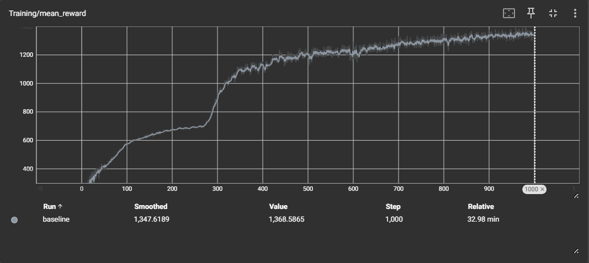
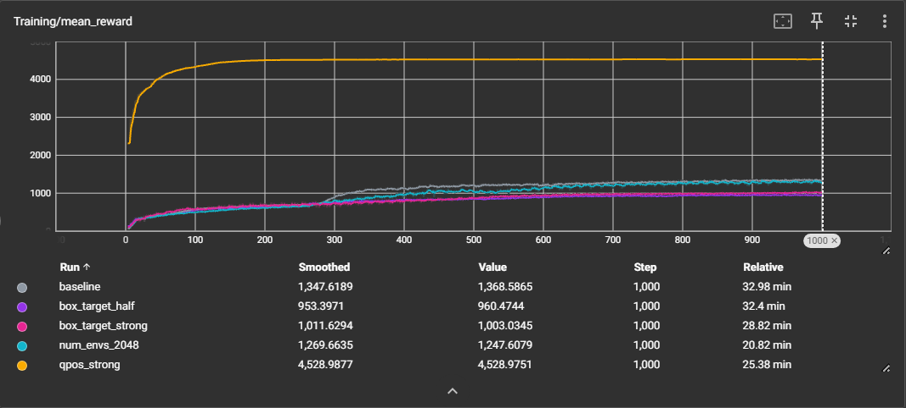
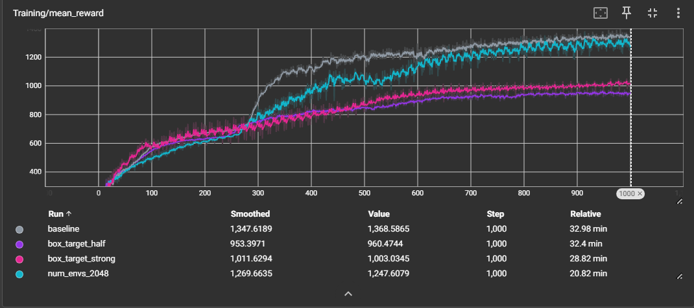

# Практика 2: эксперименты с обучением PandaPickCube

Нгуен Динь Ву, ВГУ

Задача — манипулятор Franka Panda должен взять кубик и перенести его в целевую точку. Политика обучается алгоритмом PPO (RSL-RL) в среде PandaPickCube (MuJoCo Playground). Обучение выполнялось в Google Colab на GPU T4 (локального GPU нет), оценка — скриптом `inference.py` из курса.

## Параметры обучения

Перед экспериментами я нашёл, где задаются основные параметры:

| Параметр        | Где задаётся                                                                                                      | По умолчанию                                   |
| --------------- | ----------------------------------------------------------------------------------------------------------------- | ---------------------------------------------- |
| `num_envs`      | переменная `NUM_ENVS` в ячейке настроек ноутбука (у `train.py` — флаг `--num_envs`)                               | 4096                                           |
| `learning_rate` | `cfg_dict["algorithm"]["learning_rate"]`, берётся из PPO-конфига playground (`manipulation_params.rsl_rl_config`) | 0.001 (адаптивный: к концу обучения снижается) |
| `max_iters`     | переменная `MAX_ITERS` в ноутбуке (у `train.py` — флаг `--max_iters`)                                             | 1001                                           |
| `gripper_box`   | `env_cfg.reward_config.scales.gripper_box` (конфиг среды)                                                         | 4.0                                            |

Остальные веса наград по умолчанию: `box_target` = 8.0, `no_floor_collision` = 0.25, `robot_target_qpos` = 0.3.

## Как сравнивал

Baseline: 4096 параллельных сред, 1001 итерация, seed 1, архитектура актора и критика MLP [512, 256, 128] с активацией ELU. В каждом следующем запуске менялся ровно один параметр относительно baseline.

Две метрики:

- **mean_reward** — среднее значение награды на последней итерации обучения (из лога обучения).
- **SR** — число эпизодов из 10, в которых в конце эпизода кубик оказался ближе 0.05 м к цели. Оценка: `inference.py`, последний чекпоинт `model_1000.pt`, 10 эпизодов, seed 42. Дополнительно скрипт считает «захват» (кубик поднялся выше 0.2 м).

Команды запуска у обучения нет, так как оно выполнялось в Colab (ноутбук `train.ipynb`). Что менялось, указано в столбце «Изменения в коде». Строки с весами наград вставлялись после `registry.get_default_config(ENV_NAME)` и до `registry.load(...)`.

## Результаты

| Эксперимент            | Изменения в коде                                        | mean_reward |   SR | Δ mean_reward | Δ SR | Время             | Как вёл себя робот                                                                                                                                                                                    |
| ---------------------- | ------------------------------------------------------- | ----------: | ---: | ------------: | ---: | ----------------- | ----------------------------------------------------------------------------------------------------------------------------------------------------------------------------------------------------- |
| baseline               | `NUM_ENVS=4096`, `MAX_ITERS=1001`                       |     1368.59 | 9/10 |             — |    — | 2117 с (35.3 мин) | Рука целенаправленно, без лишних движений захватывает кубик (10/10). Цель достигнута в 9 из 10 эпизодов; в 4-м кубик остановился в 5.7 см от цели.                                                    |
| num_envs_2048          | `NUM_ENVS = 2048`                                       |     1247.61 | 9/10 |       −120.98 |    0 | 1265 с (21.1 мин) | В целом хорошо: захват 10/10, цель достигнута в 9 из 10. В 4-м эпизоде кубик остановился в 7.1 см от цели; во 2-м рука действовала менее чётко, награда за эпизод заметно ниже, хотя цель достигнута. |
| box_target_strong      | `env_cfg.reward_config.scales.box_target = 40.0`        |     1003.03 | 0/10 |       −365.56 |   −9 | 1748 с (29.1 мин) | Рука приближается к кубику (по логу `gripper_box` ≈ 0.94), но не поднимает его: захват 0/10, кубик остаётся в 0.23–0.44 м от цели.                                                                    |
| qpos_strong            | `env_cfg.reward_config.scales.robot_target_qpos = 30.0` |     4528.98 | 0/10 |      +3160.39 |   −9 | 1540 с (25.7 мин) | Рука практически не выходит из стартовой позы и не приближается к кубику: захват 0/10.                                                                                                                |
| box_target_half (свой) | `env_cfg.reward_config.scales.box_target = 4.0`         |      960.47 | 9/10 |       −408.12 |    0 | 2072 с (34.5 мин) | Практически как baseline: захват 10/10, цель достигнута в 9 из 10; в 4-м эпизоде кубик остановился в 5.7 см от цели, чуть выше порога 5 см.                                                           |

Δ = значение эксперимента − значение baseline. `mean_reward` взят из лога обучения. Инференс считает награду с весами по умолчанию, поэтому средняя награда на инференсе (она есть в `inference.txt`) для экспериментов с изменёнными весами несопоставима с `mean_reward`.

Детали инференса (10 эпизодов):

| Эксперимент       | Захват | SR   | Средняя награда на инференсе | Расстояния до цели                           |
| ----------------- | ------ | ---- | ---------------------------: | -------------------------------------------- |
| baseline          | 10/10  | 9/10 |                      1503.01 | 0.002–0.057 м, неудача в эпизоде 4 (0.057 м) |
| num_envs_2048     | 10/10  | 9/10 |                      1386.32 | неудача в эпизоде 4 (0.071 м)                |
| box_target_strong | 0/10   | 0/10 |                       695.82 | 0.228–0.436 м                                |
| qpos_strong       | 0/10   | 0/10 |                       107.13 | 0.228–0.436 м                                |
| box_target_half   | 10/10  | 9/10 |                      1484.08 | неудача в эпизоде 4 (0.057 м)                |

У `box_target_strong` и `qpos_strong` расстояния до цели во всех 10 эпизодах совпадают, то есть кубик не сдвигался ни в одном из них.

## Кривые обучения

График `Training/mean_reward` в TensorBoard.

**Baseline** (`curves/baseline_tensorboard.png`): кривая идёт в три этапа. Сначала награда быстро растёт: примерно с уровня ниже 400 до ~580 к 100-й итерации. Затем рост замедляется, и с ~100-й до ~280-й итерации кривая держится на плато около 600–700. Около 280–320-й итерации происходит резкий скачок с ~700 до ~1000, после чего награда продолжает расти (~1100 к 400-й итерации) и постепенно замедляется (~1200 к 500-й, ~1300 к 800-й). К 1000-й итерации mean_reward = 1368.59 (сглаженное значение 1347.62). К концу кривая почти не растёт, но полного плато нет.



**Все пять запусков** (`curves/all.png`):



Тот же график без `qpos_strong` (`curves/all_without_qpos.png`), чтобы остальные линии были различимы:



- **qpos_strong:** награда сразу взлетает (примерно с 2300 до ~4000 к 100-й итерации), к ~200-й итерации выходит на плато около 4500 и держится на нём до конца (4528.98).
- **num_envs_2048:** примерно до 280-й итерации идёт почти вровень с baseline, затем тоже растёт, но медленнее и с заметными периодическими колебаниями. К 1000-й итерации достигает ~1250–1300 и ещё слабо растёт, немного не дотягивая до baseline.
- **box_target_strong и box_target_half:** резкого скачка, как у baseline, нет. После ~280-й итерации обе кривые растут плавно и медленно: к 1000-й итерации около 1000 у strong и около 950 у half. Кривая strong немного выше half.

Форма кривой сама по себе не показывает качество решения: у `box_target_half` кривая ниже и без скачка, но SR = 9/10 (она ниже из-за меньшего веса награды), а у `qpos_strong` кривая самая высокая, но SR = 0/10. Поэтому кривые разных конфигураций можно сравнивать только с учётом весов наград.

## Гипотезы и результаты

### num_envs_2048

- **Параметр:** `NUM_ENVS` — число параллельно работающих сред (по умолчанию 4096).
- **Изменение:** `NUM_ENVS = 2048`, остальное как в baseline.
- **Ожидание:** mean_reward ниже baseline, SR ниже 9/10, время обучения заметно меньше (baseline — 35.3 мин).
- **Обоснование:** при том же числе итераций политика получает вдвое меньше опыта (около 82 млн шагов против 164 млн), поэтому может не успеть выучить задачу так же хорошо; при этом итерации идут быстрее, так как сред меньше.
- **Результат:** время сократилось (1265 с против 2117 с) и mean_reward ниже (1247.61 против 1368.59) — совпало; SR не снизился (9/10) — не совпало.

### box_target_strong

- **Параметр:** `box_target` — вес награды за близость кубика к цели (по умолчанию 8.0).
- **Изменение:** `box_target = 40.0` (в 5 раз больше), остальное как в baseline.
- **Ожидание:** mean_reward выше baseline, SR выше (10/10).
- **Обоснование:** гораздо больший вес награды за доставку сильнее мотивирует довести кубик до цели; рост mean_reward частично вызван самим увеличением веса, поэтому прямое сравнение с baseline приблизительное.
- **Результат:** гипотеза не подтверждена: mean_reward 1003.03 (ниже на 365.56), SR 0/10. По логу обучения компонента `box_target` осталась на уровне 0.0747 (у baseline 0.7875), то есть почти не срабатывала.

### qpos_strong

- **Параметр:** `robot_target_qpos` — вес вспомогательной компоненты награды (близость суставов руки к стартовой позе, по умолчанию 0.3).
- **Изменение:** `robot_target_qpos = 30.0` (в 100 раз больше), остальное как в baseline.
- **Ожидание:** mean_reward выше baseline, SR значительно ниже (0–3 из 10); метрики разойдутся.
- **Обоснование:** при весе 30.0 эта компонента намного превышает основные (`box_target` 8.0, `gripper_box` 4.0), поэтому выгоднее оставаться в стартовой позе, а любое движение к кубику снижает награду.
- **Результат:** гипотеза подтверждена: mean_reward 4528.98 (выше на 3160.39), SR 0/10, робот не выходит из стартовой позы (по логу `robot_target_qpos` = 0.9943, `gripper_box` = 0.0421).

### Свой эксперимент: box_target_half

- **Параметр:** `box_target` (основная компонента награды, по умолчанию 8.0).
- **Изменение:** `box_target = 4.0` (в 2 раза меньше), остальное как в baseline.
- **Ожидание по mean_reward:** близко к baseline (~1368), с оговоркой, что вес награды другой.
- **Ожидание по SR:** выше, чем у baseline, 10/10.
- **Обоснование:** после уменьшения вес `box_target` сравнялся с весом `gripper_box` (4.0); награды за захват и за доставку стали более сбалансированными, поэтому робот, как я предполагал, не будет терять захват ради доставки и закончит эпизод ближе к цели.
- **Результат:** гипотеза не подтверждена: mean_reward 960.47 (ниже на 408.12, а не «близко»), SR 9/10 (равен baseline, а не 10/10).

## Выводы

По `mean_reward` сильнее всего изменился `qpos_strong` (+3160.39 к baseline), но по SR он провалился (0/10 против 9/10), то есть по SR это худший вариант: робот получал максимум награды, оставаясь в стартовой позе (`robot_target_qpos` ≈ 0.99, `gripper_box` ≈ 0.04), и вспомогательная компонента с большим весом вытеснила основную цель. В `box_target_strong` рост веса основной компоненты не помог (SR 0/10, mean_reward −365.56): по описанию курса `box_target` начисляется только после касания кубика, а в логе он остался ≈ 0.07, поэтому большой вес не сработал. Параметр масштаба (`num_envs_2048`) и умеренное снижение веса (`box_target_half`) почти не изменили SR (9/10 у обоих): `num_envs_2048` ускорил обучение примерно на 40% (21.1 против 35.3 мин) с небольшой потерей mean_reward (−120.98), а в `box_target_half` mean_reward снизился на 408.12 только из-за меньшего веса награды, при этом поведение осталось прежним. Выходит, что mean_reward и SR измеряют разное: mean_reward зависит от весов награды и при их изменении не сопоставим с baseline, а SR показывает, решена ли задача, поэтому для этой задачи главной метрикой считаю SR.

**Свой эксперимент (box_target_half):**

- **Гипотеза:** mean_reward близко к baseline, SR = 10/10.
- **Результат:** mean_reward 960.47 (Δ −408.12), SR 9/10 (Δ 0).
- **Подтверждена ли:** нет, ни по mean_reward, ни по SR.
- **Совпали ли метрики:** нет — mean_reward заметно упал, а SR не изменился.
- **Объяснение:** при весе `box_target` = 4.0 каждая единица «близости к цели» оценивается вдвое ниже, поэтому mean_reward снижается даже при том же поведении (по логу `box_target` ≈ 0.78, как у baseline — 0.79), а SR показывает, что робот по-прежнему решает задачу. Гипотезу о росте SR я не подтвердил: в эпизоде 4 кубик остановился в 5.7 см от цели, как и у baseline.

## Файлы

```
├── README.md
├── train.ipynb              — ноутбук для Colab (вариант baseline; для остальных запусков менялись строки из таблицы)
├── curves/                  — графики mean_reward из TensorBoard
└── experiments/<имя>/       — по папке на каждый запуск:
    ├── config.json              конфиг обучения
    ├── model_1000.pt            финальная модель, на ней считался SR
    ├── events.out.tfevents.*    логи TensorBoard
    ├── inference.txt            вывод проверки на 10 эпизодах
    └── <имя>.mp4                видео 10 эпизодов
```

Промежуточные чекпоинты (каждые 50 итераций) не включены. Кривые можно посмотреть командой `tensorboard --logdir experiments`. Скрипты оценки `inference.py`, `config.py` и `device_utils.py` взяты из репозитория курса (Practice_1) и здесь не дублируются.

Запуск оценки:

```
python3 inference.py --checkpoint experiments/<имя>/model_1000.pt --episodes 10 --record <имя>.mp4
```
